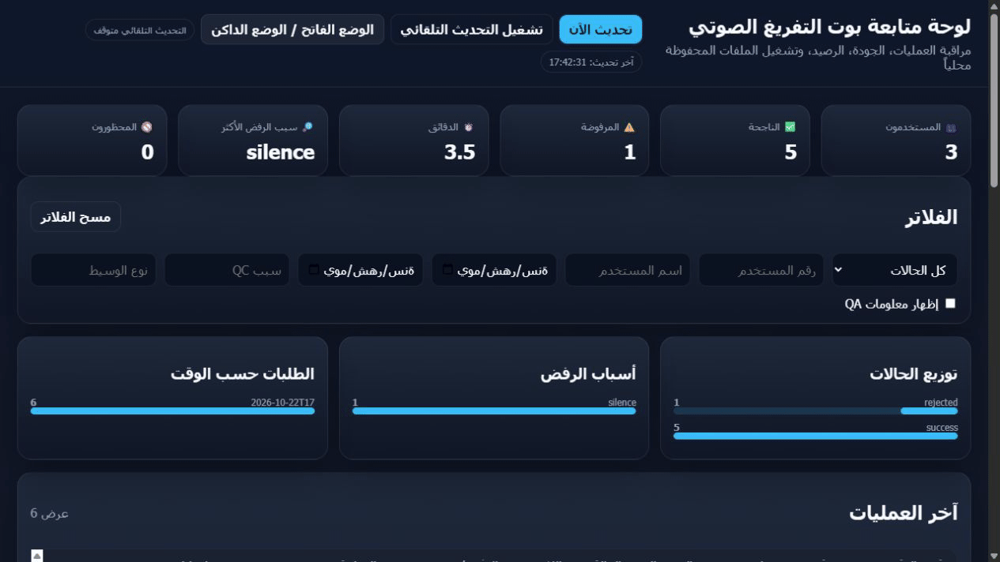

# Local Telegram Voice-to-Text Bot

A Telegram bot that transcribes voice messages, audio files, and video audio
on the host machine using faster-whisper. It includes Arabic user messages,
daily usage quotas, transcript quality checks, and a local monitoring dashboard.



Ten-second walkthrough of the running local dashboard with synthetic users and
sample transcript records. It demonstrates the monitoring and detail views;
it does not show a Telegram conversation or an actual transcription run.

Transcription uses a local model. Telegram still transports the submitted media
and returned text. A Telegram bot token is required; no paid speech API key is
needed.

[التوثيق العربي](README_AR.md)

## Features

- FFmpeg conversion to 16 kHz mono audio and duration checks before inference.
- Automatic language detection, with heuristics for mixed Arabic/English speech.
- Full-file transcription, one retry without the initial prompt, and conditional
  overlapping chunk fallback when quality checks flag a result.
- Checks for prompt leakage, repetition, low-confidence segments, and silence.
- Plain and timestamped text files delivered through Telegram.
- SQLite daily quotas, administrator balance adjustments, bans, and processing logs.
- A dashboard bound to localhost for reviewing users, results, and rejection reasons.

## Run locally

Use Python 3.13. Install FFmpeg and ensure both `ffmpeg` and `ffprobe` are on PATH.
Create a Telegram bot with [BotFather](https://t.me/BotFather).

```bash
python -m venv .venv
# Windows PowerShell: .venv\Scripts\Activate.ps1
# macOS/Linux: source .venv/bin/activate
python -m pip install -r requirements-lock.txt
```

Copy `.env.example` to `.env` and set `TELEGRAM_BOT_TOKEN`. The example selects
the `small` model with CPU inference and `int8` compute. The first transcription
downloads the model weights; later runs can reuse the local cache.

```bash
python bot.py
```

Send a voice message or supported audio/video file, then use `/balance` to check
the daily allowance. Run the optional monitoring dashboard in a separate terminal:

```bash
python dashboard_server.py
```

The dashboard opens at `http://127.0.0.1:8765`. It has no login and is intended
for the machine operator. See [operations](docs/OPERATIONS.md) for GPU setup,
administrator commands, and retention behavior.

## Processing flow


Inference calls share a process-local lock. The bot is designed for one polling
process; it does not provide a distributed queue or concurrent GPU scheduling.

## Verification and limits

```bash
python scripts/check_release.py
python -m pytest -q
```

Tests cover quota accounting, quality-control decisions, chunk boundaries,
mocked inference, media handling, and failure paths. Synthetic audio checks use
FFmpeg when installed. CI runs on Windows and Linux without a bot token, model
download, or GPU. See [testing](docs/TESTING.md).

These checks do not establish transcription accuracy. There is no published
word-error-rate benchmark for Arabic dialects or mixed-language speech. Quality
rules can reject valid speech or accept an incorrect transcript. Overlapping
chunks can repeat words at boundaries; speaker diarization is unimplemented.

The Telegram cloud Bot API imposes its own download limit, so the configured
30-minute duration cap does not guarantee every file can be downloaded.

## Data and licensing

The repository excludes live audio, transcripts, databases, logs, and credentials.
Running the bot creates sensitive records locally; read [privacy](docs/PRIVACY.md)
before offering it to other people. [License notice](LICENSE_NOTICE.md).
